<!--
    CERTIFICATION CHEST

    Structure:
	
	

		<b>Pranic Healing Center</b>,
		Pranic Healing Basic Course,
		Official Certificate, 2026.
	

	
	

    todo frames.jpg:
    Used when adding decorative frames to certificates.
-->

    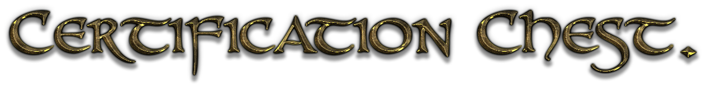
     
    Contains all the remaining and off-topic certifications.
     
    Makes CVs and portfolios <b>dynamic</b> and <b>compact!</b>

    

<b>Certifications!</b>

 

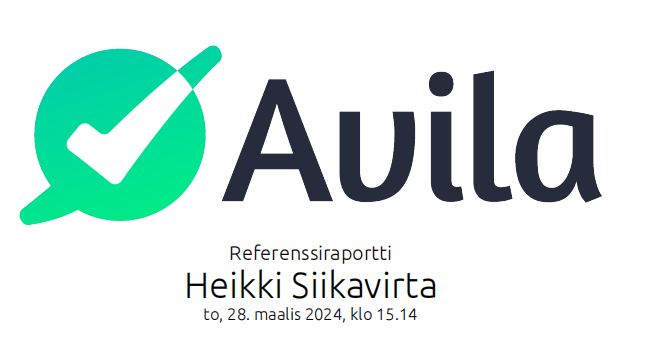

    

    <b>Avila</b>, Reference Report, 2024.

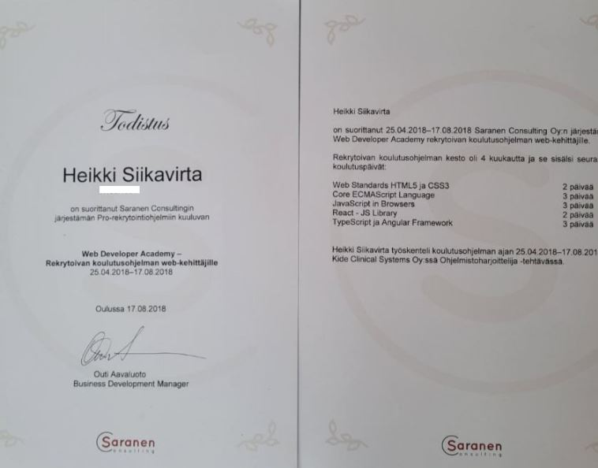

    

    <b>Saranen Consulting</b>, Web Developer Academy,
    Official Certificate, 2018.

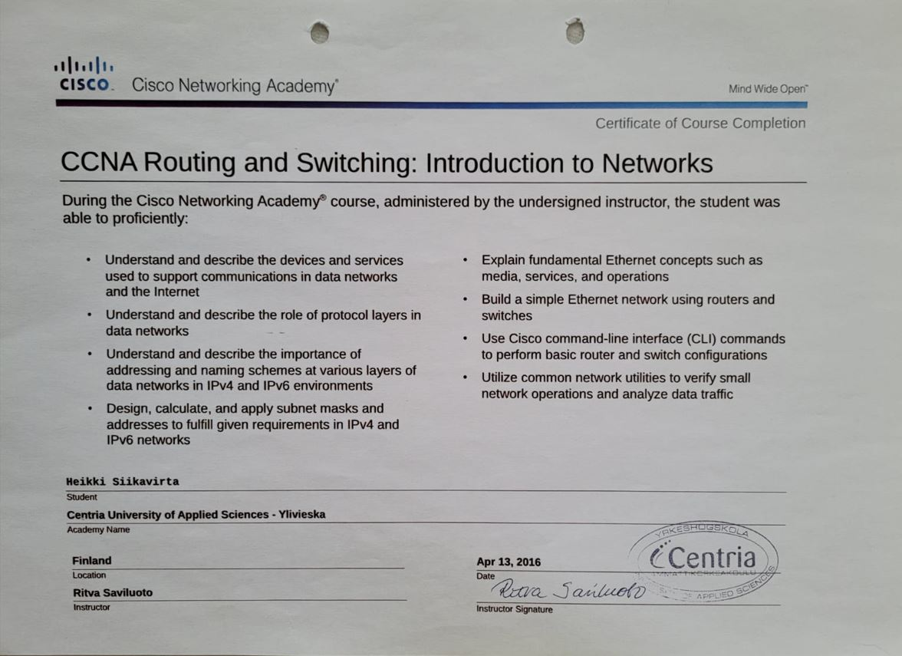

    <b>Cisco Networking Academy</b>,
    CCNA Routing and Switching: Introduction to Networks,
    Official Certificate, 2016.

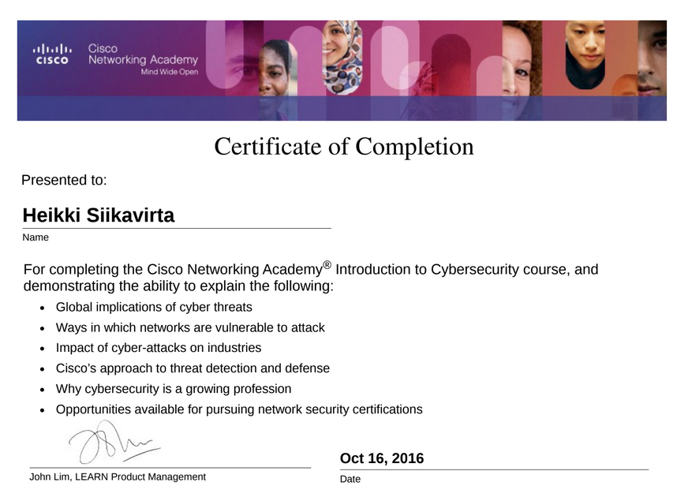

    <b>Cisco Networking Academy</b>,
    Introduction to Cybersecurity,
    Official Certificate, 2016.

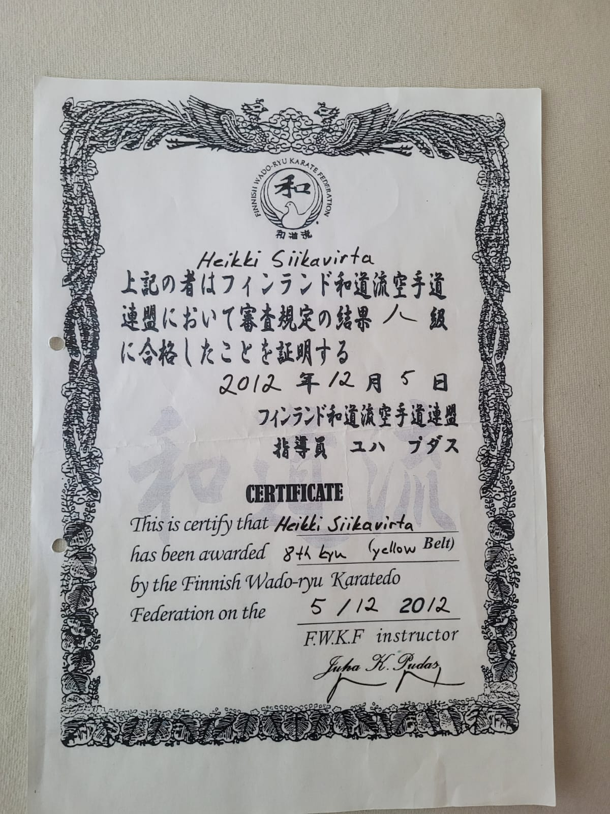

    <b>Wado-ryu</b>, Sport Certificate, 2012.
	

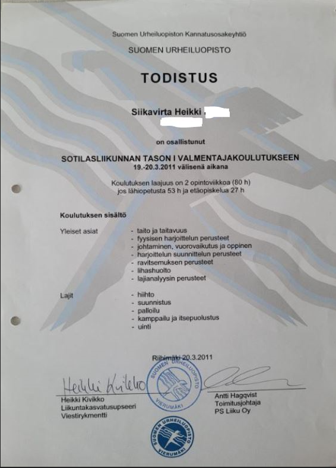

    <b>Finnish Army</b>, Military Sport Certificate, 2011.

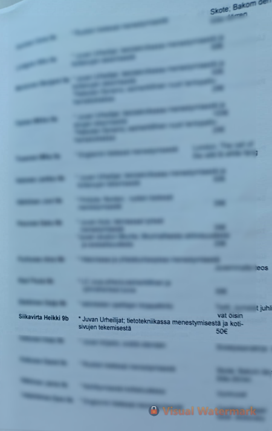

    <b>Juva's High School</b>,
    Homepage Upkeep and Creation Certificate, 2006.

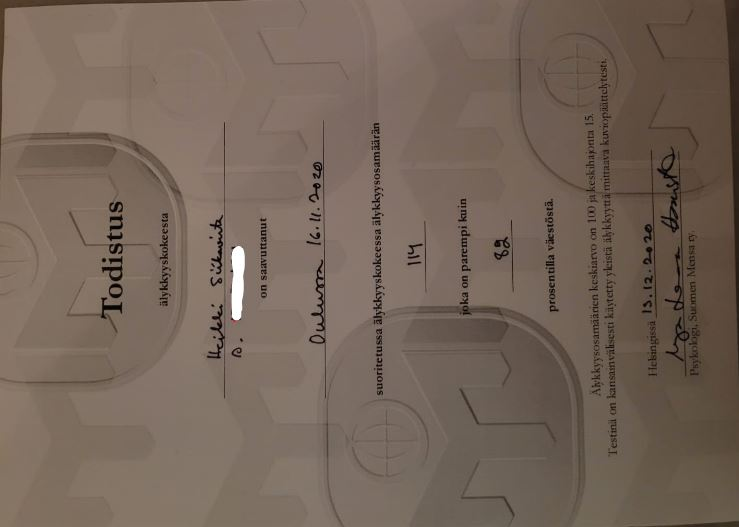

    <b>Finnish Mensa ry</b>, IQ Test Official Certificate, 2020.
     
    When I was a tired, busy bee!
    

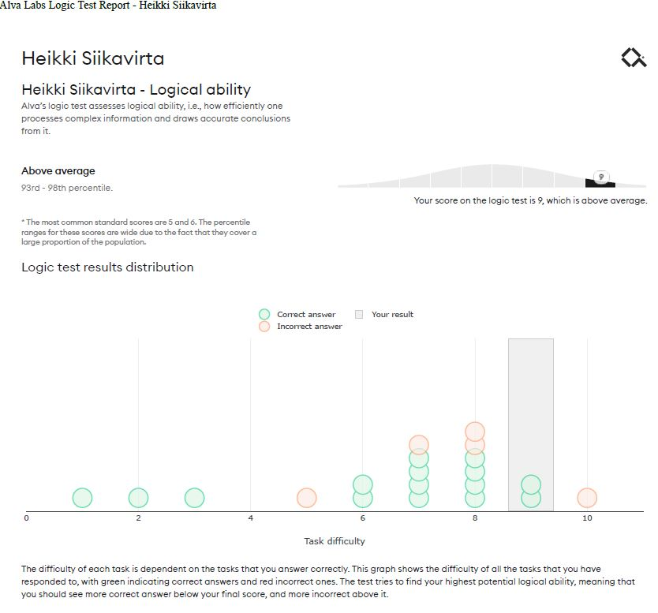

    

    <b>Alva Labs</b>, Logic Test Official Certificate, 2026.
     
    That day I was pulling an all-nighter!
    

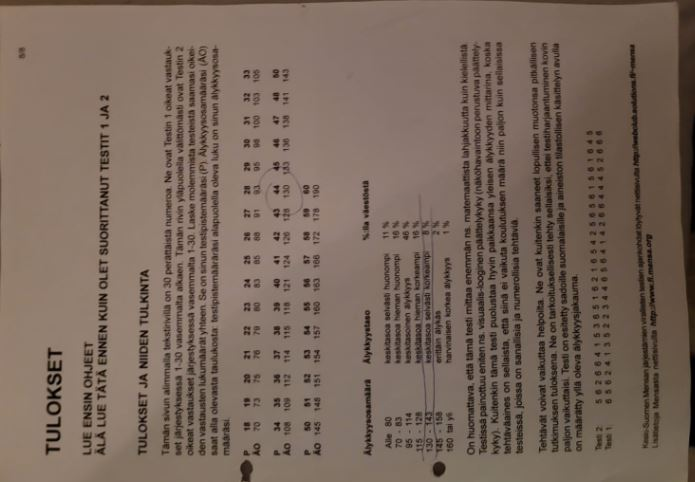

    <b>Kide Systems</b>, First Block Test,
    Unofficial Certificate, 2018.
     
    This was when I got my first IT job!

<!--
    FROM HERE DOWN:
    SPORTS AND NON-TECHNICAL CERTIFICATIONS
-->

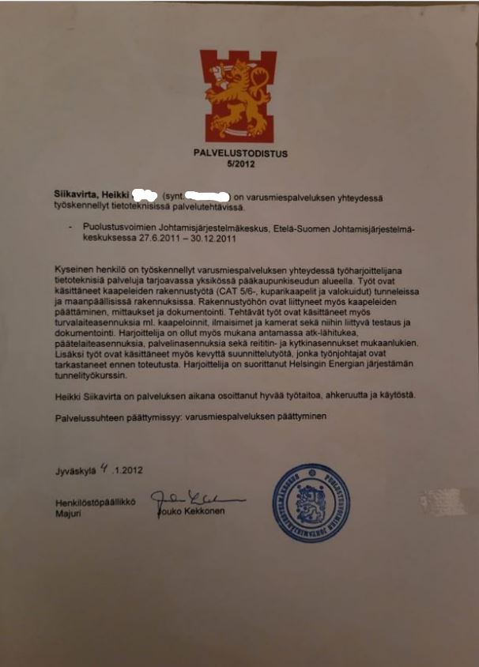

    <b>Helsingin Energia</b>, Tunnel Course,
    Official Certificate, 2011.
	<a href="#">
		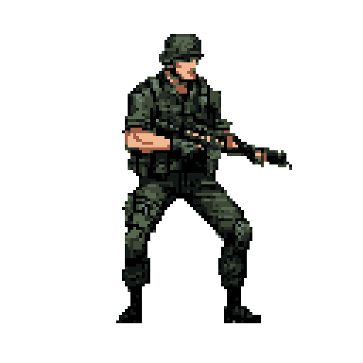
	</a>

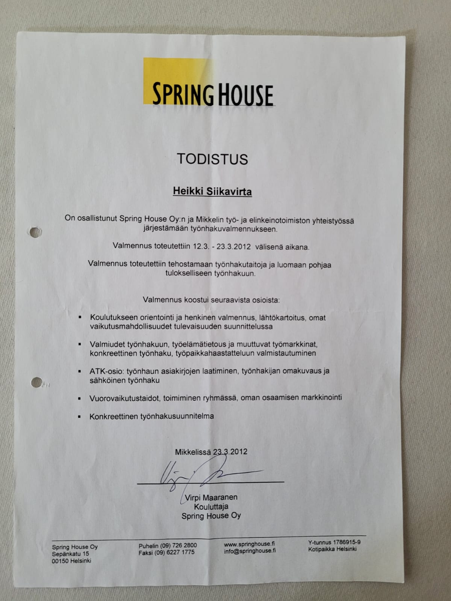

    <b>Spring House</b>, Effective Job Seeking,
    Official Certificate, 2012.
     
    When I was at the mercy of MOL!

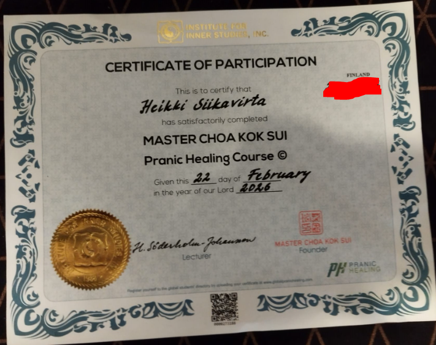

    <b>Pranic Healing Center</b>,
    Pranic Healing Basic Course,
    Official Certificate, 2026.

	

